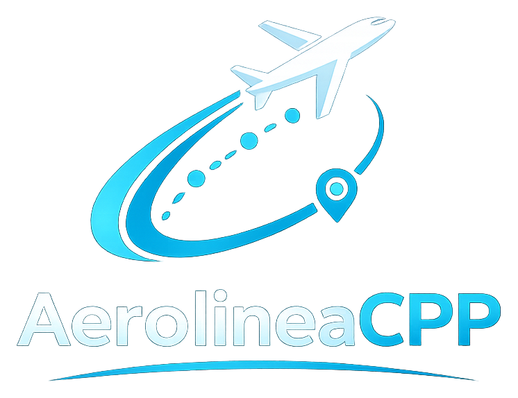
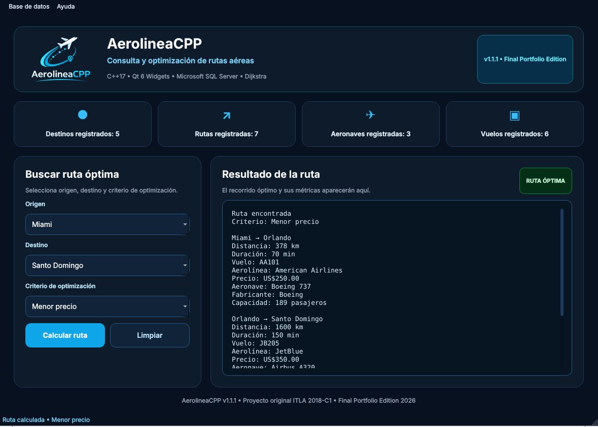

<p align="center">
  
</p>

<p align="center">
  
  
  
</p>

<p align="center">
  <a href="https://github.com/Jairo0811/Aerolinea/actions/workflows/release-windows.yml">
    
  </a>
</p>

<p align="center">
  
  
  
  
</p>

# Aerolinea / AerolineaCPP

**Aerolinea** nació como proyecto final de **Estructuras de Datos (SOF-012)** en el **Instituto Tecnológico de Las Américas (ITLA)** durante **2018-C1**. La versión original de consola utilizaba listas enlazadas para modelar destinos y relaciones.

En 2026 el proyecto fue recuperado sin borrar su historia. El repositorio conserva dos etapas deliberadamente separadas:

- `legacy/`: código académico original restaurado para entornos actuales.
- `modern-qt-sqlserver/`: **AerolineaCPP**, reinterpretación de escritorio con C++17, Qt 6, SQL Server, CMake, seguridad reforzada, pruebas y CI/CD.

La edición **v1.1.0 — Final Portfolio Edition** cerró la modernización como pieza de portafolio y **v1.1.1 — Final Portfolio Maintenance Release** cierra su mantenimiento: configuración correcta para instalaciones en `Program Files`, reconexión, metadatos de Windows, correcciones de Dijkstra y un pipeline de release único y reproducible. El proyecto queda **Portfolio Complete / Frozen**: solo se aceptan correcciones, no expansión hacia un sistema comercial de operación aérea.

## Qué demuestra este proyecto

Este repositorio está diseñado para mostrar evolución técnica a través del tiempo:

```text
2018-C1
C++ de consola
   ↓
Listas enlazadas y estructuras de datos
   ↓
2026
C++17 + Qt 6 Widgets
   ↓
SQL Server + ODBC + CMake
   ↓
Dijkstra multicriterio + pruebas + CI/CD + hardening
```

## AerolineaCPP v1.1.1

La aplicación consulta un grafo de rutas almacenado en SQL Server y permite calcular un recorrido óptimo según cuatro criterios:

| Criterio | Estrategia |
|---|---|
| **Menos escalas** | costo uniforme por tramo |
| **Menor distancia** | peso por kilómetros |
| **Menor duración** | peso por minutos |
| **Menor precio** | peso por precio del vuelo |

Todos los criterios se resuelven con **Dijkstra** sobre el grafo dirigido de rutas (en *menor precio* cada tramo usa su vuelo más barato y se descartan los tramos sin precio). Los empates se resuelven de forma estable. El resultado incluye los tramos, vuelo, aerolínea, aeronave, capacidad, escalas, distancia total, duración total y precio total cuando existe información de precio para todo el recorrido.

### Funcionalidades

- Consulta de destinos desde SQL Server.
- Consulta de rutas, vuelos y aeronaves.
- Búsqueda de rutas directas y con escalas.
- Optimización multicriterio.
- Cálculo de distancia, duración y precio agregados.
- Resumen de destinos, rutas, aeronaves y vuelos registrados.
- Interfaz Qt 6 en tema oscuro y diseño adaptable de escritorio.
- Configuración externa mediante `database.ini`, en modo instalado (carpeta del usuario) o portable (junto al ejecutable).
- **Reintentar conexión** (`F5`) y **Abrir carpeta de configuración** sin reiniciar la aplicación.
- Recursos visuales embebidos en el ejecutable, con metadatos de versión de Windows.
- Ventana **Acerca de** con contexto académico y créditos.
- Paquete portable para Windows x64 generado por GitHub Actions.
- Instalador profesional de Windows generado con Inno Setup.

## Vista de la aplicación

<p align="center">
  
</p>

<p align="center"><sub>Ruta de menor precio Miami → Santo Domingo con los datos de <code>Aerolinea.sql</code>.</sub></p>

> **Alcance correcto:** AerolineaCPP es una aplicación de **consulta y optimización de rutas**. No ofrece CRUD administrativo de datos desde la GUI y no se presenta como un sistema de reservas u operación real de aerolíneas.

## Seguridad

La edición final incorpora límites de confianza explícitos:

- cifrado de conexión SQL mediante TLS;
- `trustServerCertificate=false` por defecto;
- autenticación integrada como opción preferida;
- usuario y contraseña SQL mediante `AEROLINEA_DB_USER` y `AEROLINEA_DB_PASSWORD`;
- `database.ini` excluido del control de versiones y almacenado fuera de `Program Files` en modo instalado;
- controlador restringido a Microsoft ODBC Driver 17/18;
- timeout e intención de lectura;
- validación de valores procedentes de SQL Server;
- consultas estáticas o parametrizadas;
- constraints, índices únicos y claves foráneas en la base de datos;
- rol de mínimo privilegio `AerolineaReader`;
- mitigaciones del compilador y linker;
- pipeline de build con permisos de solo lectura y publicación aislada.

Consulta [SECURITY.md](SECURITY.md) para el modelo de seguridad y reporte de vulnerabilidades.

## Pruebas y CI

**20 pruebas** Qt Test/CTest, sin GUI ni SQL Server:

- `RutaManagerTests` (15): los cuatro criterios, destino inexistente o inalcanzable, origen = destino, mayúsculas/minúsculas, totales de distancia/duración/precio/escalas, vuelo más barato por ruta, tramos sin precio, precios inválidos, ciclos y empates deterministas.
- `ConfiguracionTests` (5): precedencia portable/usuario, creación de la configuración inicial desde la plantilla, no sobrescritura de un `database.ini` existente y valores predeterminados.

Un único workflow, [`release-windows.yml`](.github/workflows/release-windows.yml), ejecuta en cada pull request:

1. **Contrato real contra SQL Server 2022** (contenedor efímero con contraseña aleatoria por ejecución): `Aerolinea.sql` dos veces para comprobar idempotencia, tablas, claves foráneas, seed y permisos SELECT-only de `AerolineaReader`.
2. **Build Release + pruebas** en Windows con Qt 6.8.3 / MSVC, verificando los metadatos de versión del `.exe`.
3. **ZIP portable y `Setup.exe`**, con **instalación silenciosa en `Program Files`**, arranque de la aplicación instalada, creación de la configuración de usuario, **desinstalación silenciosa** y comprobación de que se conserva la configuración personal.

La publicación es manual (`workflow_dispatch` con `vX.Y.Z`): exige que la versión coincida con `CMakeLists.txt`, se ejecuta solo desde `master`, nunca reescribe un tag existente y publica los cuatro assets desde un job separado que es el único con permiso `contents: write`.

## Instalación

### Requisitos

- Windows 10/11 x64.
- Microsoft SQL Server.
- Microsoft ODBC Driver 17 u 18 for SQL Server.
- TLS correctamente configurado para el servidor de base de datos.

### Instalador recomendado

1. Descarga `AerolineaCPP-v1.1.1-Setup.exe` desde **GitHub Releases**.
2. Ejecuta el instalador y acepta los permisos de administrador para instalar en `Program Files`.
3. El asistente registra **AerolineaCPP** en el menú Inicio y permite crear opcionalmente un acceso directo en el escritorio.
4. Ejecuta `Aerolinea.sql` con permisos para crear/configurar `AerolineaDB`.
5. Inicia AerolineaCPP. La primera vez crea tu `database.ini` de usuario a partir de la plantilla.
6. Menú **Base de datos → Abrir carpeta de configuración**, ajusta servidor y opciones TLS, y pulsa **Reintentar conexión** (`F5`). No hace falta editar `Program Files`.
7. Para autenticación SQL usa `trustedConnection=false` y define `AEROLINEA_DB_USER` y `AEROLINEA_DB_PASSWORD`.
8. Asigna al principal de la aplicación únicamente el rol `AerolineaReader`.

El instalador incluye desinstalador y aparece en las aplicaciones instaladas de Windows. Al desinstalar se eliminan los archivos del programa y **se conserva tu `database.ini` personal**; si quieres borrarlo, elimina la carpeta indicada abajo.

> **Firma digital:** el instalador de portafolio no está firmado con un certificado Authenticode comercial. Dependiendo de la reputación del archivo, Windows SmartScreen puede mostrar una advertencia antes de ejecutarlo.

### Paquete portable

Como alternativa al instalador:

1. Descarga `AerolineaCPP-v1.1.1-Windows-x64.zip` desde **GitHub Releases**.
2. Extrae completamente el ZIP.
3. Ejecuta `Aerolinea.sql` con permisos para crear/configurar `AerolineaDB`.
4. Copia `config/database.example.ini` como `config/database.ini`.
5. Configura servidor, base de datos y autenticación.
6. Para autenticación SQL define las variables `AEROLINEA_DB_USER` y `AEROLINEA_DB_PASSWORD`.
7. Asigna al principal de la aplicación únicamente el rol `AerolineaReader`.
8. Ejecuta `AerolineaCPP.exe`.

### Configuración: instalada vs. portable

`database.ini` se busca en este orden:

| Prioridad | Modo | Ubicación |
|---:|---|---|
| 1 | Portable | `config\database.ini` junto a `AerolineaCPP.exe`, si existe |
| 2 | Instalado / usuario | `%LOCALAPPDATA%\JM Software Solutions\AerolineaCPP\database.ini` (`QStandardPaths::AppConfigLocation`), creado una vez desde la plantilla y nunca sobrescrito |
| 3 | Predeterminado | valores seguros internos (`localhost\SQLEXPRESS`, `AerolineaDB`, TLS, autenticación integrada) |

`database.example.ini` es solo una plantilla: nunca se usa como configuración. El archivo no admite contraseñas; las credenciales SQL vienen siempre de variables de entorno.

### Verificación de integridad

Cada archivo de la release tiene su `.sha256`. En PowerShell:

```powershell
(Get-FileHash .\AerolineaCPP-v1.1.1-Setup.exe -Algorithm SHA256).Hash.ToLower()
Get-Content .\AerolineaCPP-v1.1.1-Setup.exe.sha256
```

## Arquitectura

```text
                 AerolineaCPP

              Qt 6 Widgets GUI
                     │
                     ▼
                 MainWindow
                     │
          ┌──────────┴──────────┐
          ▼                     ▼
     RutaManager          DatabaseManager
          │                     │
          ▼                     ▼
  Dijkstra / grafo        Qt SQL / ODBC
          │                     │
          └──────────┬──────────┘
                     ▼
        Ruta · Vuelo · Destino · Aeronave
                     │
                     ▼
              SQL Server 2022
```

Más detalle en [docs/ARCHITECTURE.md](docs/ARCHITECTURE.md).

## 🧱 Stack tecnológico

### 🖥️ Aplicación

<p>
  
</p>

- C++17
- Qt 6 Core / Widgets / SQL
- Programación orientada a objetos
- Algoritmos de grafos y Dijkstra

### 🗄️ Datos

<p>
  
</p>

- Microsoft SQL Server 2022
- ODBC
- Script SQL idempotente con constraints, índices y rol de solo lectura

### 🧪 Ingeniería y distribución

<p>
  
</p>

- CMake
- Qt Test
- CTest
- Inno Setup
- Git / GitHub
- GitHub Actions
- GitHub Releases

## Estructura

```text
Aerolinea/
├── .github/workflows/
│   └── release-windows.yml      # CI + release genérica
├── docs/
│   ├── ARCHITECTURE.md
│   └── screenshots/
├── installer/
│   └── aerolineacpp.iss
├── legacy/
│   └── Proyecto académico restaurado de 2018-C1
├── modern-qt-sqlserver/
│   ├── tests/
│   │   ├── rutamanager_tests.cpp
│   │   └── configuracion_tests.cpp
│   ├── config/
│   │   └── database.example.ini   # plantilla embebida
│   ├── app_icon.rc.in             # icono + metadatos de versión de Windows
│   ├── Aerolinea.sql
│   ├── CMakeLists.txt
│   └── Código fuente Qt/C++
├── CHANGELOG.md
├── LICENSE
├── SECURITY.md
└── README.md
```

## 🎓 Información académica

| Dato | Información |
|---|---|
| Institución | Instituto Tecnológico de Las Américas (ITLA) |
| Asignatura | Estructuras de Datos |
| Código | SOF-012 |
| Profesor | Raydelto Hernández Perera |
| Período | 2018-C1 |
| Modalidad | Proyecto final grupal |

### 👥 Equipo académico original

| 👤 Integrante | 🆔 Matrícula |
|---|---|
| 👨🏻‍💻 Francis Jairo Matías Rosario | 2015-2984 |
| 👨🏻‍💻 Jorge de Jesús Torres Pérez | 2016-3515 |
| 👨🏻‍💻 Sebastian Donastor Hernández | 2016-3607 |

La modernización de 2026 preserva explícitamente esos créditos y no convierte retroactivamente el trabajo grupal original en una obra individual.

## 🧭 Continuidad académica

Aerolinea forma parte de una secuencia formativa cursada con el profesor **Raydelto Hernández Perera**. La relación es académica y cronológica; los repositorios no son dependencias técnicas entre sí.

| Orden | Asignatura | Proyecto | Período |
|---:|---|---|---|
| 1 | Programación II (SOF-004) | [**Eventix**](https://github.com/Jairo0811/Eventix) | 2017-C2 |
| 2 | Estructuras de Datos (SOF-012) | **Aerolinea** | 2018-C1 |
| 3 | Programación WEB (SOF-011) | [**ITLA Crush**](https://github.com/Jairo0811/ITLAcrushReact) | 2018-C2 |

## Lo que AerolineaCPP no intenta ser

No es un Passenger Service System (PSS), GDS, motor de reservas ni sistema certificado para operación aérea. No implementa, entre otras cosas:

- reservas y pasajeros;
- inventario real de asientos;
- emisión de tickets;
- pagos;
- check-in;
- horarios operacionales;
- gestión de tripulación;
- NDC / Offers & Orders;
- integraciones con aerolíneas reales.

Ese límite es intencional. El valor del proyecto está en **estructuras de datos, algoritmos, modernización de legado, seguridad, persistencia y prácticas de ingeniería**, no en competir con plataformas aeronáuticas empresariales.

## Estado del proyecto

### Portfolio Complete / Frozen

La v1.1.0 fue el cierre funcional y la **v1.1.1** la versión final de mantenimiento. El proyecto queda congelado.

Solo se aceptan:

- vulnerabilidades reales;
- bugs reales;
- incompatibilidades futuras con Windows, Qt, CMake, ODBC o SQL Server;
- actualizaciones obligatorias de dependencias;
- errores documentales importantes.

No se aceptan nuevas funcionalidades, módulos, rediseños periódicos ni expansión comercial.

## Licencia y uso

El código se publica para revisión académica y de portafolio. El proyecto original fue grupal y conserva múltiples titulares de derechos. Consulta [LICENSE](LICENSE) antes de copiar, redistribuir, modificar o utilizar comercialmente el código.
